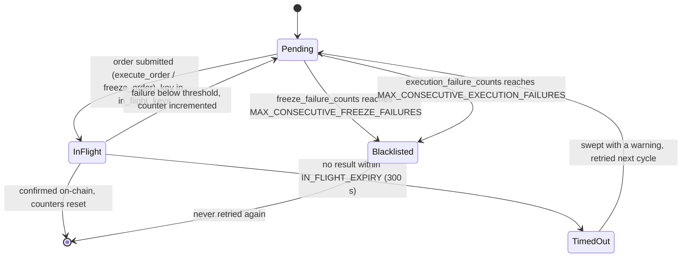

# Keeper Failure State Machine

The keeper loop (`oracle/src/keeper_loop.rs`) moves each order key through a
small failure model whose state lives in `AppState` (`oracle/src/state.rs`).
Constants are referenced by name so this document and the code can be diffed.

## State diagram

## Transitions

| Transition | Trigger | Counter | Threshold | Observable signal | Operator action |
|---|---|---|---|---|---|
| Pending → In-flight | Keeper cycle submits the order and records the key in `in_flight_keys` | — | — | Key present in `in_flight_keys`; `oracle_orders_executed_total` on success | None |
| In-flight → Confirmed | Transaction confirmed | `execution_failure_counts` entry reset on success | — | Key removed from `in_flight_keys` | None |
| In-flight → Timed-out | `sweep_expired_in_flight_keys` finds the key older than `IN_FLIGHT_EXPIRY` (300 s) | — | `IN_FLIGHT_EXPIRY` | Warning log from the sweep (#801) | Verify the tx on Horizon; the order is retried next cycle |
| In-flight → Pending (retry) | `execute_order`/`freeze_order` returned an error | `execution_failure_counts` / `freeze_failure_counts` incremented (reset on success) | Below `MAX_CONSECUTIVE_EXECUTION_FAILURES` (5) / `MAX_CONSECUTIVE_FREEZE_FAILURES` (3) | Error log; `GET /oracle/failed-submissions?operation=` | Usually none — transient failures retry automatically |
| → Blacklisted (freeze path) | Consecutive `freeze_order` failures | `freeze_failure_counts` | `MAX_CONSECUTIVE_FREEZE_FAILURES` (3, #498) | Loud alert (#498); key in `frozen_order_blacklist`; `blacklisted_keys` in `GET /keeper/status` | Fix the underlying order, then `DELETE /keeper/blacklist/{key}` |
| → Blacklisted (execute path) | Consecutive `execute_order` failures of any kind (#803) | `execution_failure_counts` | `MAX_CONSECUTIVE_EXECUTION_FAILURES` (5) | Key in `frozen_order_blacklist`; `blacklisted_keys` in `GET /keeper/status` | Fix the underlying order, then `DELETE /keeper/blacklist/{key}` |
| Blacklisted | — | — | — | Order never re-enters the loop | The blacklist is in-memory: a restart clears it and frozen orders may be re-submitted |

## Error patterns (oracle/src/keeper_loop.rs)

- `BUDGET_EXCEEDED_PATTERN` (`"Budget, ExceededLimit"`) — Soroban diagnostic
  substring for contract budget exhaustion. Since #803 it counts toward
  `execution_failure_counts` like any other execute failure.
- `MARKET_PAUSED_PATTERN` (`"MarketPaused"`) — contract error emitted when a
  market's circuit breaker is tripped (#1256).

## Cycle limits (oracle/src/keeper_loop.rs)

- `KEEPER_CYCLE_TIMEOUT_SECS` (50) — hard cap on a single keeper cycle (#490).
- `POST_SET_PRICES_SETTLE_MS` (5 000) — settle delay after a confirmed
  `set_prices` tx before simulating executions against it (#956).
- `IDLE_BACKOFF_MULTIPLIER` (4) — when a cycle finds no pending work, the next
  cycle is delayed by 4× the normal interval (#1281).

## Related operator tooling

See [RUNBOOK.md](RUNBOOK.md) for symptom-by-symptom diagnosis. The counters
and lists above are visible through `GET /keeper/status` (`blacklisted_keys`)
and `GET /oracle/failed-submissions?operation=&limit=`.
